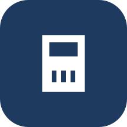
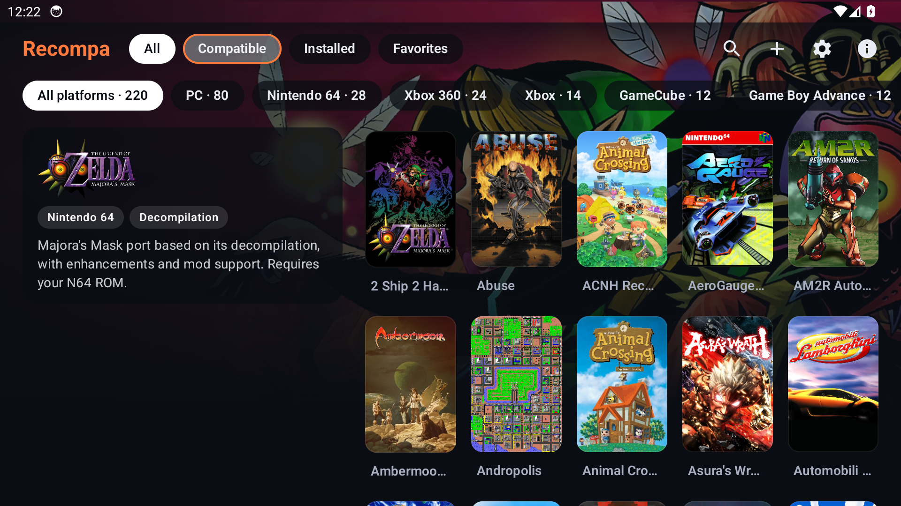
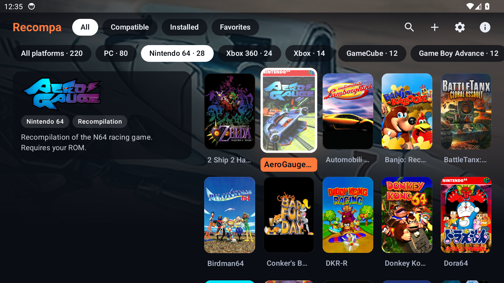
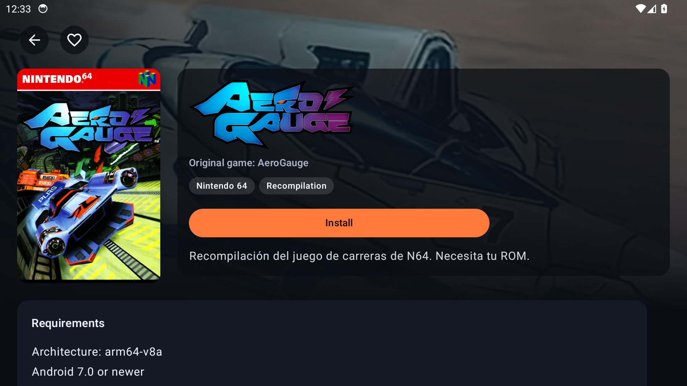

<div align="center">

  

  <h1>Recompa</h1>

  **Native ports of your favorite games, in one Android launcher.**

  <p>
    
    
    
    
    <a href="LICENSE"></a>
  </p>

  <a href="https://github.com/kalasyan/recompa/releases/latest/download/recompa.apk">
    
  </a>
  <a href="https://recompa.app/">
    
  </a>

</div>

---

## 📖 About

**Recompa** is an Android launcher for **native game ports**: recompilations, decompilations and source ports that run without emulation.

Pick a game, install its port straight from the author's GitHub, set up your copy of the game and play. Recompa is built for controllers and handhelds like the AYN Thor.

## ✨ Features

- 🎮 **Over 130 ports** from PC, N64, Xbox 360, GameCube, GBA, PSP and more.
- 🖼 **Cover art** and a dark launcher UI made for the D-pad and shoulder buttons.
- 🔒 **Verified installs:** every APK's SHA-256 and signature are checked before installing.
- 🧩 **Game files wizard** that checks your ROM or data files and gets them ready.
- 🔄 **Updates** for ports from inside the app: update everything at once, get notified when ports have new versions, or go back to an earlier version if an update breaks something.
- ⬆️ **Recompa updates itself:** it tells you when a new version is out (in the app and with a notification) and installs it over the current one.
- 📥 **Background downloads:** leave the app while ports download, verify and install. Progress shows as a notification.
- 🔗 **Fork links:** every fork on a port's page opens its GitHub repository, so you can see where a port comes from.
- 📌 **Link ports you already have:** "I already have it installed" links a port you installed outside Recompa. If it doesn't match the catalog's package or signature, Recompa warns you and won't update it.
- 🔍 **Search and favorites**, both one button away on the gamepad (X and Y).
- 🕹 **Frontend mode:** full screen, and Recompa can be your handheld's home screen.
- 📊 **Compatibility reports:** see how each port runs on other players' devices, and report your own. No GitHub account needed.
- 💡 **Suggest a port:** send a GitHub repository for the catalog from the library, or when a search finds nothing. Also without a GitHub account.
- 🌍 **Languages:** English, Spanish, French, Portuguese and German, picked in Settings (or in Android's app language settings on Android 13+).

## 📸 Screenshots

<p align="center">
  
  
</p>
<p align="center">
  
</p>

## 📥 Install

Website and download page: <https://recompa.app/>

1. On your Android device (8.0 or later), open <https://github.com/kalasyan/recompa/releases/latest/download/recompa.apk> and open the downloaded file.
2. Android will ask you to allow installing apps from your browser or file manager. Allow it to install Recompa. If Google Play Protect says it is harmful, tap **More details** and then **Install anyway** (see below).
3. The first time you open Recompa, it explains the permission it needs to install ports.
4. Pick a port, tap **Install** and, if it needs game files, use **Files you need** on its page.

**About the Play Protect warning:** Play Protect distrusts new apps that are not on Google Play and can install other apps, as any store does. It has not found anything specific in Recompa: you can check by uploading the APK to [VirusTotal](https://www.virustotal.com/). Since 0.3.0 Recompa no longer asks to see every installed app (`QUERY_ALL_PACKAGES`), one of the things that made Play Protect suspicious. Its code is public, it is always signed with the same key, and the warning fades as more people install it.

Recompa tells you when a new version is out and updates itself from inside the app. You can also track it with [Obtainium](https://github.com/ImranR98/Obtainium) by adding `https://github.com/kalasyan/recompa`.

**Test builds:** every push to `main` publishes a `nightly-N` release. Nightlies use a different signing key from stable versions, so switching between them requires uninstalling first. See [RELEASING.md](RELEASING.md) for stable releases.

## 💬 Feedback

- **Problems with a port:** use **Report how it runs** on its page in Recompa. Reports go to this repository's issues, with or without a GitHub account.
- **A port missing from the catalog:** use **Suggest a port** in the library, or open a [port suggestion](https://github.com/kalasyan/recompa/issues/new?template=port.yml).
- **Problems with Recompa itself:** open an [issue](https://github.com/kalasyan/recompa/issues).

## 👩‍💻 Development

Requirements: JDK 17 and the Android SDK.

```bash
./gradlew :core:test          # logic tests
./gradlew :app:assembleDebug  # debug APK
```

The port catalog is managed in a private repository and published at <https://recompa.app/index.json>.

The download website lives in `site/` and is published next to the catalog on GitHub Pages (`python site/build.py OUT_DIR` builds it; needs Pillow).

## 🤖 Use of AI

This project was built with the help of AI tools (Claude, by Anthropic) for research, design and part of the code.

## ⚖️ Legal notice

Recompa does not include, host or download games, ROMs, ISOs or any other copyrighted files. Each port needs a legitimate copy of the original game. Ports belong to their authors and are downloaded from their own repositories.

Recompa is not affiliated with or endorsed by Nintendo, Sega, Sony, Microsoft or any game publisher or developer. All trademarks belong to their respective owners.

## 📄 License

[GPL-3.0](LICENSE).
